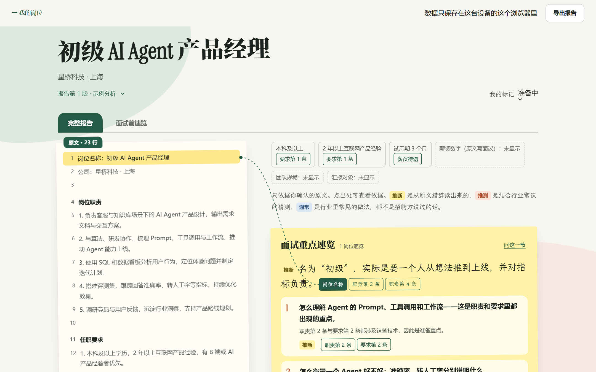
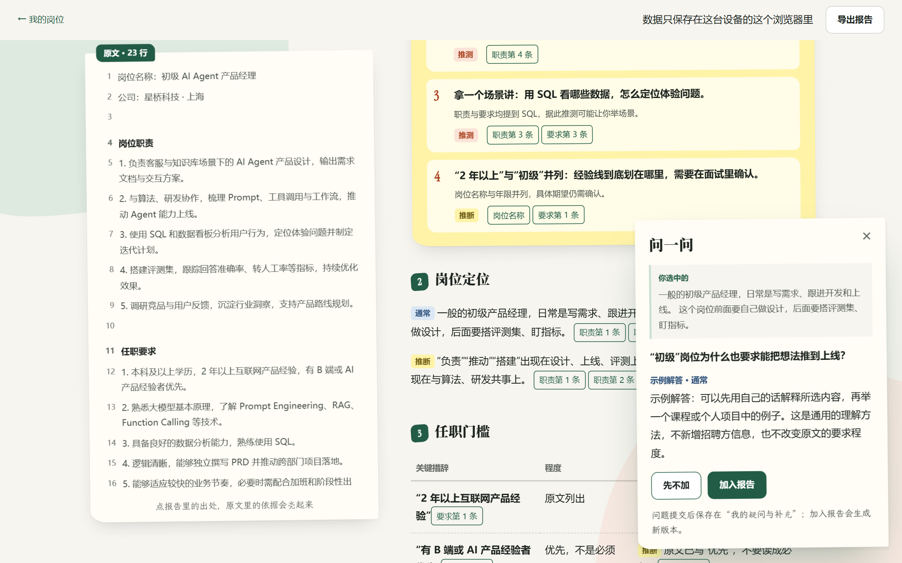
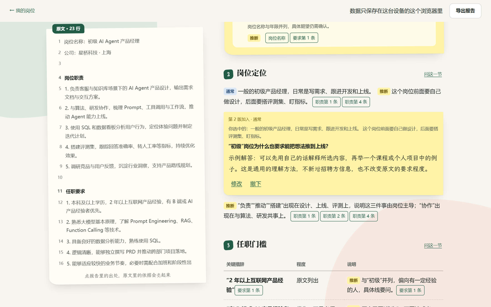
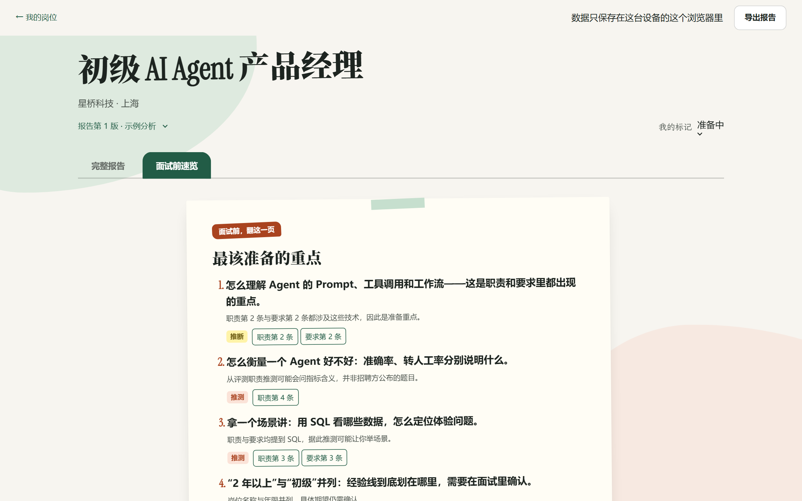
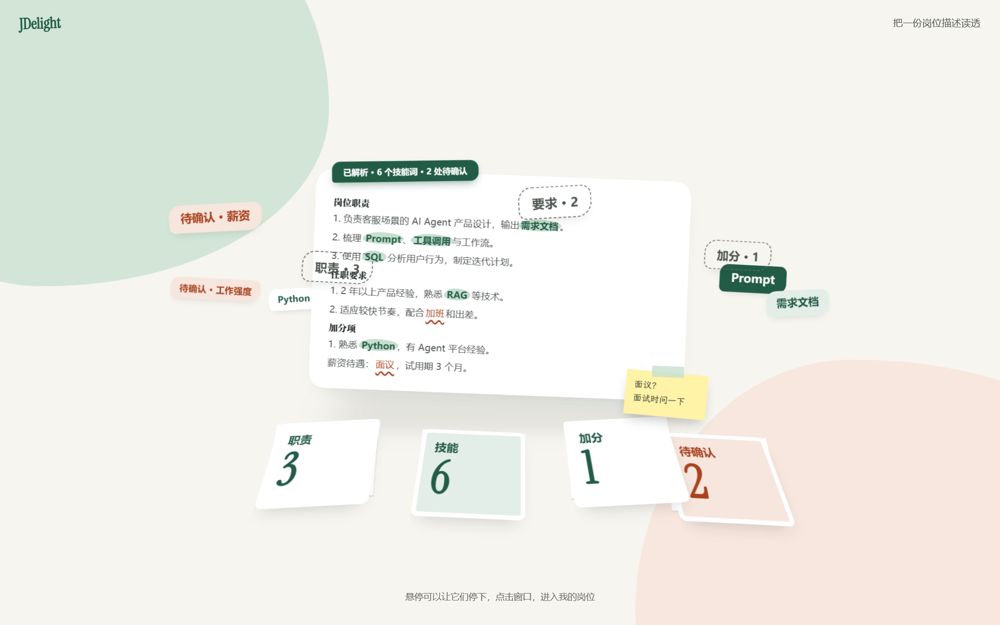
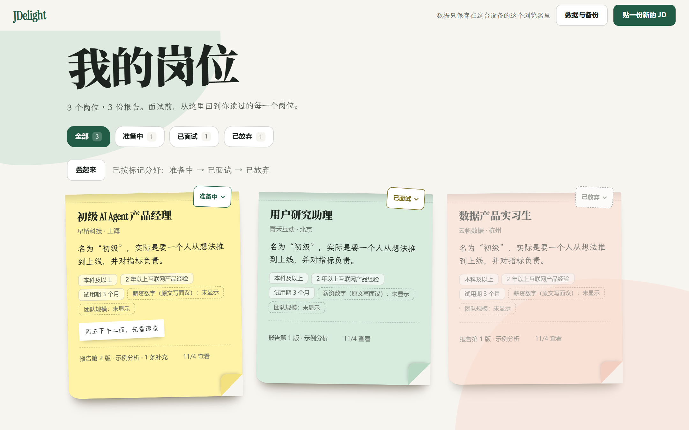
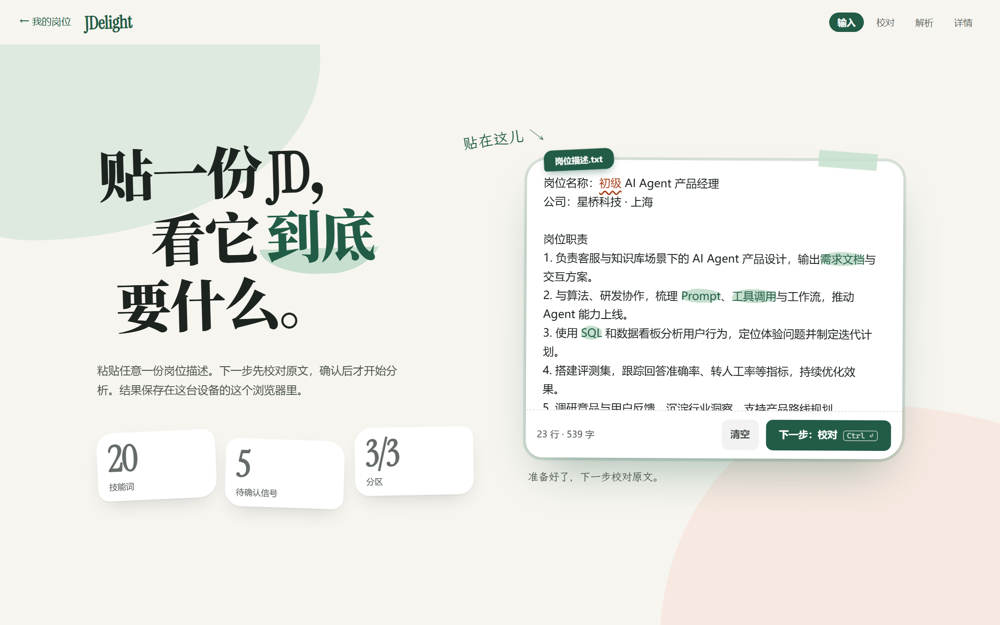
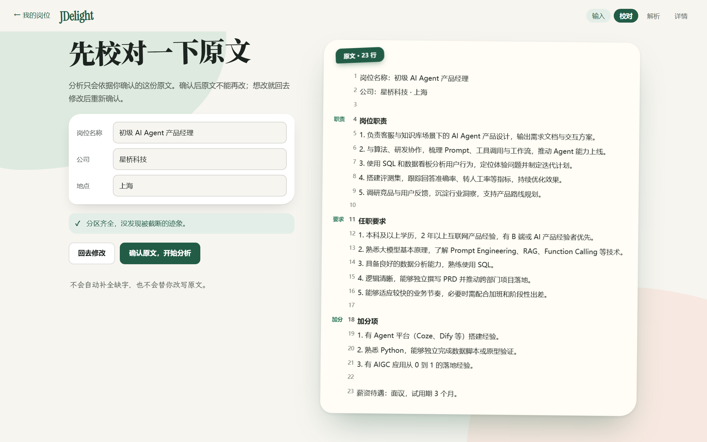
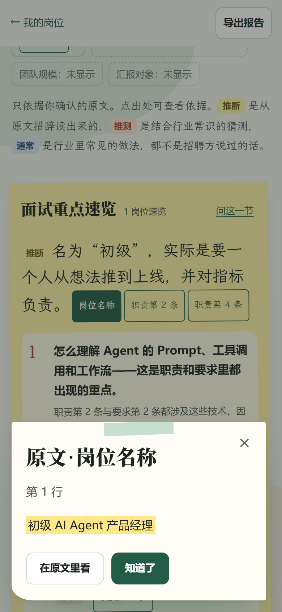

<div align="center">

# JDelight

**把一份 JD 读成一份岗位分析报告。**

帮在校求职者读懂岗位真正要什么，面试前一页回看。

    

</div>



## 为什么做

校招 JD 往往只有十几行，却藏着很多信息：“初级”却要求 2 年经验，“熟悉”和“精通”差在哪，哪些是必备、哪些只是加分。新手很难读出这些，面试前也没有一份能回看的东西。

JDelight 只做一件事：**把你粘贴的那份 JD 读透，并且每个结论都能回到原文。**

## 亮点

### 1. 七章系统分析，每句话都有出处

报告分七章：岗位定位、任职门槛、隐含要求、能力解析、场景推测、准备建议、待确认事项，开头还有一张“面试重点速览”。每条结论都挂着原文行号，点一下，左侧原文就会高亮，并用一根线连过去。

每句话还会标明来源：**推断**（从原文措辞读出）、**推测**（结合行业常识）、**通常**（行业常见做法），不会把猜测写成招聘方的原话。

### 2. 哪里不懂，选中就问；答案并回报告

 

选中报告里任意一段，或者点“问这一节”。觉得解答有用，就加入报告，生成新版本。旧版本只读保留，随时可以回看，补充内容也能修改或撤下。

### 3. 面试前，翻这一页



“面试前速览”汇总最该准备的重点、你问过的问题和反问理由。可以复制全文，或者打印成 PDF 带去面试。

### 4. 数据只在你的浏览器里

不用注册，也不上传。岗位、原文和每一版报告都存在本机 IndexedDB 里。“数据与备份”可以导出成一个 JSON 文件，换设备时导入即可：导入前先预览，可以选择合并或替换，失败会整体回滚。

### 5. 分析过不了检查，就不展示

分析结果要先通过 7 项结构与引用校验，例如出处必须真实存在于原文、“优先”不能写成“必备”，通过后才会保存和展示。分析前也要你先校对原文：工具只提示缺分区和疑似截断，不会替你补全。

## 更多界面

| 3D 开场 | 我的岗位 |
| --- | --- |
|  |  |
| **粘贴 JD** | **校对原文** |
|  |  |

<p align="center"></p>
<p align="center"><sub>手机端：点出处，原文以浮层显示</sub></p>

> 截图来自本地模拟模式，岗位与公司均为虚构示例。

## 三步跑起来

需要 Node.js 24（见 `.nvmrc`）。默认是本地模拟模式，**不需要任何账号、密钥或 `.env`**。

```sh
npm ci
npm run build
npm run start   # 打开 http://localhost:3000，点“试试示例”
```

开发时用 `npm run dev`。如果要接入真实模型分析（OpenAI 兼容接口），配置方式见 [开发说明](docs/开发说明.md)。

## 技术栈

- **Next.js 16 App Router + React 19 + TypeScript strict**
- **Dexie / IndexedDB**：本地优先存储，原文和报告不可变，按版本追加
- **Zod**：报告数据结构与 V1–V7 校验
- **three.js + Motion**：开场 3D 与过渡动效；系统开启“减少动态效果”时直接呈现最终画面
- **Vitest + Playwright + axe**：单元测试、真实浏览器端到端测试和无障碍检查

## 项目状态

个人项目，持续迭代中。已经完成本地完整流程：粘贴、校对、分析、提问补充、版本管理、速览导出、备份导入。真实模型分析与邀请码试用模式还在验证。

开发细节、测试命令与数据契约见 [docs/开发说明.md](docs/开发说明.md)。

## 许可

代码使用 [MIT](LICENSE)。手写字体 JDelight Notes 是霞鹜文楷的子集，遵循 OFL；Instrument Serif 来自 Fontsource。来源与许可证见 `public/fonts/`。
